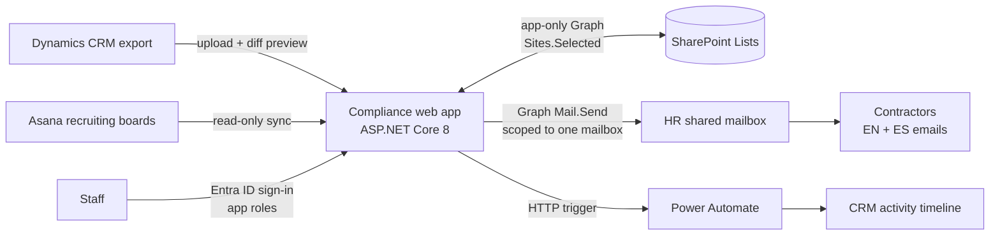

# Contractor Compliance & Lifecycle System

> A staff web app that tracks a company's independent contractors from first lead to active work, chases expiring insurance and licenses with bilingual emails, and stops operations from scheduling anyone who isn't compliant.

**Built for:** a ~150-employee facility services franchise (3 offices), where I'm the sole IT person
**When:** July – August 2026, in production since
**Stack:** C# / ASP.NET Core 8 (Razor Pages) · Microsoft Entra ID · Microsoft Graph · SharePoint Lists · Dynamics CRM exports · Asana API · Power Automate · PowerShell · Docker · Render
**My role:** Designed, tested and deployed it. Built with Claude Code as an AI pair programmer.

> The source code belongs to my employer and stays private. This page describes what I built and how. Happy to walk through it in an interview.

---

## The problem

The company works with hundreds of independent contractors. Each one needs current general liability insurance, workers' comp (or a valid exemption) and a business license. Before this app:

- HR sent the same generic reminder email to every contractor with anything expiring.
- Operations had no quick way to see whether a contractor was cleared to work before scheduling them.
- Recruiting leads lived in Asana, active contractors lived in the CRM, and nothing tied the two together.

That gap was a real audit risk.

## What it does

- **Mirrors the CRM.** Imports CRM exports into SharePoint Lists with a diff preview (new / changed / unchanged / exceptions) before anything is written, plus a full change log. The CRM stays the system of record.
- **Compliance gate.** Works out, live, whether each contractor is cleared to schedule, document by document (Good / 60 days / 30 days / Expired), including the workers' comp rules (when it's required and when an exemption is enough).
- **Bilingual renewal emails.** English and Spanish in one message, personalized per contractor and document. Bulk select, review, approve and send, with a full history per contractor. Sent emails are logged back onto the contractor's CRM timeline through a Power Automate flow.
- **One lifecycle, three boards.** Onboarding, Active and Archive, derived from CRM data rather than stored separately, so the boards can't disagree with the record.
- **Recruiting import.** Pulls leads from two Asana boards into the same database, including open-house invitations.
- **Document upload.** HR files a renewed certificate on the record, which stops the renewal chase and reminds HR to update the CRM.
- **Two franchises, kept separate.** Per-franchise roles so each office only sees its own contractors.
- **Stale-data warning** on every screen if the daily CRM update hasn't landed.

## Architecture

**Security choices**
- Three separate Entra app registrations (sign-in, SharePoint data, mail), each with only the permission it needs.
- SharePoint access limited to the app's own site (`Sites.Selected`).
- Mail sending locked to a single HR mailbox with an Exchange application access policy, verified with `Test-ApplicationAccessPolicy` (granted for the HR mailbox, denied for everyone else).
- Secrets kept in a password manager and environment variables, never in code.
- A development-only override redirects every test email to a safe inbox.

## Results

| Measure | Result |
|---|---|
| Contractor records imported (first CRM export) | 334, then about 2,100+ after reconciliation |
| Compliance dashboard | 1,911 flagged records cut to **64 real, actionable ones** |
| Duplicate reconciliation | 2,227 rows → 2,158, zero duplicates |
| Recruiting leads imported from Asana | 170 |
| Real bulk send verified | 72 emails |
| Automated verification checks | 346, 0 failures |
| Lifecycle tasks documented for leadership | 87 |

## Problems I found and fixed

- **Microsoft Graph pagination.** An import reported 334 records created but only 200 showed up. Graph pages list items at 200 by default and the service wasn't following `@odata.nextLink`. One shared paging helper fixed it for every list in the app.
- **Wrong email template for everyone.** SharePoint number fields come back through Graph as strings like `"60.0"`, so a strict integer parse silently fell back to the default tier. Every contractor was getting the wrong template until I caught it.
- **A field that could never be cleared.** The write path silently dropped empty values, which quietly broke "reopen a lead" and "clear this receipt." Fixed and proven against the live list.
- **The whole roster blocked from scheduling.** A workflow field defaulted to "New" on import, so all 1,655 records read "not cleared," including 339 working contractors. The CRM's status now settles activation.
- **Container crash on deploy.** A config file watcher exhausted the host's inotify limit; switched to a polling watcher.
- **Mail permission "Access is denied".** Admin consent had never actually been granted, and a running process holds its old token. Granted consent, restarted, documented the lesson.

## What I'd do next

- CRM-ready export for leads that graduate to active contractors
- Orientation payment workflow (Ops picks, contractor pays, Accounting activates)
- Bring the second office's CRM data in once its export is available

---

*Part of a set of internal tools I built for the same company. See my [profile](https://github.com/Matteoinfl) for the others.*
